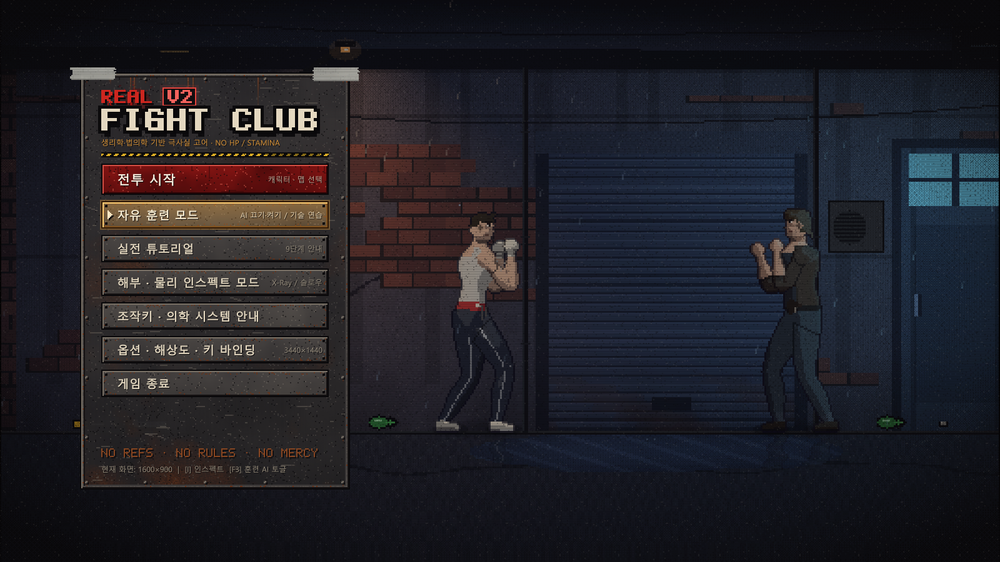
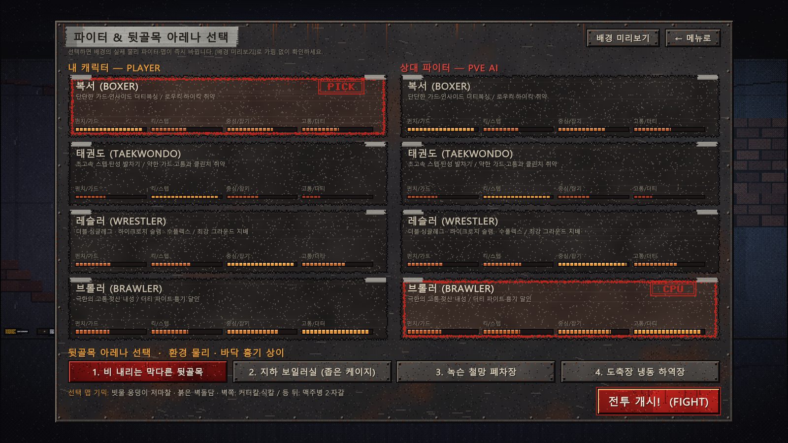

# REAL FIGHT CLUB — V2.1

> 생리학 · 법의학 기반 극사실 고어 × 소프트 바디 × "새벽 3시 뒷골목" 길거리 도트 UI 2D 스트리트 파이팅 (Windows 64-bit)

가짜 HP · 스태미나 바가 없습니다. 의식, 뇌산소, 혈액량(5L), 근육 ATP · 젖산, 뼈 · 관절 건전성, 동맥 출혈, 전정기관 평형 같은 **실제 의학 · 생리 지표**와 2D 액티브 래그돌 + 소프트 바디 절차적 애니메이션으로 싸웁니다.

## ⬇️ 다운로드 & 실행

1. 오른쪽 **[Releases](../../releases/latest)** 에서 최신 `FightClub_Windows_x64.zip` 을 받습니다.
2. 아무 폴더에 **압축을 전부 풉니다** (`FightClub_Data` 폴더가 `FightClub.exe` 옆에 있어야 합니다).
3. `FightClub.exe` 를 실행합니다.

- 설치 필요 없음 · Windows 10/11 64-bit
- 처음 실행할 때 Windows SmartScreen이 뜨면 **추가 정보 → 실행** 을 누르세요 (서명되지 않은 인디 빌드라서 그렇습니다).

## 🎮 기본 조작

| 동작 | 키 |
|---|---|
| 이동 / 숙이기 | `A` `D` / `S` |
| 앞손 · 뒷손 펀치 | 마우스 좌 · 우클릭 (누른 채 휙 끌면 **훅 · 어퍼컷**) |
| 가드 | `L-Shift` 또는 마우스 휠클릭 (커서 높이 = 가드 높이) |
| 앞발 · 뒷발 킥 | `Q` `E` (커서 높이로 로우 · 미들 · 하이) |
| 엘보우 · 니킥 | `V` `C` |
| 클린치 · 테이크다운 · 줍기 | `R` (레슬러: 클린치에서 `R` 꾹 → 들어 올린 뒤 `F` 메치기, `R` 그립 해제) |
| 더티 파이트 | `Z` 눈찌르기 · `X` 깨물기 · `G` 박치기 · `F` 선택 기술 (휠로 전환) |
| 흉기 | 좌클릭 베기 · 우클릭 찌르기 · `F` 투척 · `S`+`F` 내려놓기 |
| 테이크다운 방어 | `Alt`+휠↓ (또는 `Alt`+`S`) 스프롤 · `Alt`+휠↑ (또는 `Alt`+`W`) 언더훅 |
| 회피 · 탈출 · 기상 | `Space` (잡혔거나 쓰러졌을 때 연타) · `S`+`Space` 테이크다운 페인트 |
| 메뉴 · 인스펙트 · X-Ray | `ESC` · `I` · `F1` |

모든 키는 **옵션 → 키 바인딩**에서 바꿀 수 있습니다. 처음이라면 메인 메뉴의 **실전 튜토리얼 (9단계)** 부터 해보세요.

## 🥊 파이터 & 맵

- **복서** · **태권도** · **레슬러** · **브롤러** — 체급, 유연성, 통증 내성, 기술 숙련도가 모두 다릅니다.
- **비 내리는 뒷골목** · **지하 보일러실** · **녹슨 철망 폐차장** · **도축장 냉동 하역장** — 바닥 마찰, 벽 반동, 증기 화상, 바닥 흉기가 맵마다 다릅니다.

## 📸 스크린샷

## ✨ V2.1 주요 업데이트 — "새벽 3시 뒷골목" 길거리 도트 UI 전면 리워크

- **17종 절차적 도트 UI 재질**: 녹슨 리벳 강판, 나트륨 가로등 조명 버튼, 마른 피 강판, 지하 격투 복사 전단지(캐릭터 카드), 응급실 클립보드 차트 종이, 녹색 형광 CRT 모니터(인스펙트 · X-Ray), 젖은 아스팔트 띠(자막 · HUD), 황·흑 경고 테이프, 은색 덕트 테이프, 핏자국 데칼, 디더링 비네트 + 주사선
- **정수 격자 스냅 & 굵은 한글 도트 텍스트**: Point 필터 + 화면 픽셀 격자 스냅으로 어떤 해상도에서도 정사각 도트 유지, 제목/버튼은 2배 정수 확대 도트 글자 + 본문은 선명 1:1 도트 그림자
- **전 화면 UI 통일**: 메인 메뉴(네온 V2 로고), 파이터 · 맵 선택, 조작 안내, 옵션 · 키 바인딩, 튜토리얼, 자유 훈련 툴바, 전투 배너 · 자막, 인스펙트 오버레이, 사후 응급실 의학 차트까지 전면 교체

이전 V2 / V1 업데이트 내역 보기

### V2 (생리학 · 법의학 고어 & 소프트 바디)
- 17종 손상 기전별 법의학 상처 표현 & 해부학 층별 조직 단면(진피→지방→근막→근섬유→피질골/늑골)
- 실루엣 변형 외상(국소 부종, 골절 각변형, 개방 골절 골편 돌출, 복부 장기 탈출)
- 전신 혈역학 피부색(실혈 창백 · 청색증 · 목 압박 울혈/점상출혈) & 두부 중력 방향 피 흐름 · 치아 파편
- 심장 박동 연동 동맥 분출(방울 분열), 정맥 낙하 방울, 피 웅덩이 · 발자국 · 캐스트오프(BPA)
- 곡선 신체 메시, 4단 톤 래스터라이저, 시각 전용 소프트 바디 & 2차 모션(머리카락/띠/재킷/눈 깜빡임), 120Hz 프레임 보간 & 히트스톱 0.25x 비주얼 슬로모션

### V1 (QA 전면 패치)
- 마우스 드래그 훅 · 어퍼컷, 키보드 기본 가드(`L-Shift`), 실전 단축키 오입력 방지
- 바닥 흉기 배치 개편 및 브롤러 AI 개시 직후 흉기 돌진 수정, `S`+`F` 흉기 내려놓기, 레슬러 `R` 그립 해제
- 투척 판정 확장, 튜토리얼 9단계 확장, 오디오 환경별 분리 및 스레드 안정화

---

© byungshinsekki · 개인 인디 프로젝트. 실행 파일은 자유롭게 플레이할 수 있으나 재배포 · 판매는 금지합니다.
