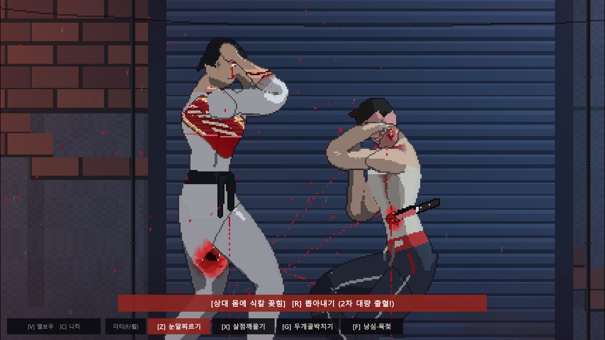

# REAL FIGHT CLUB — V2

> 생리학 · 법의학 기반 극사실 고어 & 소프트 바디 절차적 2D 픽셀 스트리트 파이팅 (Windows 64-bit)

가짜 HP · 스태미나 바가 없습니다. 의식, 뇌산소, 혈액량(5L), 근육 ATP · 젖산, 뼈 · 관절 건전성, 동맥 출혈, 전정기관 평형 같은 **실제 의학 · 생리 지표**와 2D 액티브 래그돌 + 소프트 바디 절차적 애니메이션으로 싸웁니다.

## ⬇️ 다운로드 & 실행

1. 오른쪽 **[Releases](../../releases/latest)** 에서 최신 `FightClub_Windows_x64.zip` 을 받습니다.
2. 아무 폴더에 **압축을 전부 풉니다** (`FightClub_Data` 폴더가 `FightClub.exe` 옆에 있어야 합니다).
3. `FightClub.exe` 를 실행합니다.

- 설치 필요 없음 · Windows 10/11 64-bit
- 처음 실행할 때 Windows SmartScreen이 뜨면 **추가 정보 → 실행** 을 누르세요 (서명되지 않은 인디 빌드라서 그렇습니다).

## 🎮 기본 조작

| 동작 | 키 |
|---|---|
| 이동 / 숙이기 | `A` `D` / `S` |
| 앞손 · 뒷손 펀치 | 마우스 좌 · 우클릭 (누른 채 휙 끌면 **훅 · 어퍼컷**) |
| 가드 | `L-Shift` 또는 마우스 휠클릭 (커서 높이 = 가드 높이) |
| 앞발 · 뒷발 킥 | `Q` `E` (커서 높이로 로우 · 미들 · 하이) |
| 엘보우 · 니킥 | `V` `C` |
| 클린치 · 테이크다운 · 줍기 | `R` (레슬러: 클린치에서 `R` 꾹 → 들어 올린 뒤 `F` 메치기, `R` 그립 해제) |
| 더티 파이트 | `Z` 눈찌르기 · `X` 깨물기 · `G` 박치기 · `F` 선택 기술 (휠로 전환) |
| 흉기 | 좌클릭 베기 · 우클릭 찌르기 · `F` 투척 · `S`+`F` 내려놓기 |
| 테이크다운 방어 | `Alt`+휠↓ (또는 `Alt`+`S`) 스프롤 · `Alt`+휠↑ (또는 `Alt`+`W`) 언더훅 |
| 회피 · 탈출 · 기상 | `Space` (잡혔거나 쓰러졌을 때 연타) · `S`+`Space` 테이크다운 페인트 |
| 메뉴 · 인스펙트 · X-Ray | `ESC` · `I` · `F1` |

모든 키는 **옵션 → 키 바인딩**에서 바꿀 수 있습니다. 처음이라면 메인 메뉴의 **실전 튜토리얼 (9단계)** 부터 해보세요.

## 🥊 파이터 & 맵

- **복서** · **태권도** · **레슬러** · **브롤러** — 체급, 유연성, 통증 내성, 기술 숙련도가 모두 다릅니다.
- **비 내리는 뒷골목** · **지하 보일러실** · **녹슨 철망 폐차장** · **도축장 냉동 하역장** — 바닥 마찰, 벽 반동, 증기 화상, 바닥 흉기가 맵마다 다릅니다.

## 📸 스크린샷

## 🔥 V2 주요 업데이트 (REAL FIGHT CLUB V2)

**생리학 · 법의학 극사실 고어 & 혈액 유체**
- **17종 손상 기전별 법의학 상처 표현**: 주먹(관절열 멍), 팔꿈치, 쇠파이프(이중선 멍), 각목, 유리 파편, 커터칼, 식칼, 중식도(찍힘 · 뼈 홈), 사람 치아(상하 치열 + 흡인 점상출혈), 증기 습열 화상, 콘크리트 찰과 등 기전에 따라 전혀 다른 상처 형태
- **해부학 층별 조직 단면**: 진피 → 피하지방 → 근막 → 근섬유 → 피질골 · 늑골 · 체강까지 부위별 실제 조직 두께에 비례해 깊게 벌어짐
- **실루엣 변형 외상**: 국소 부종 및 팽팽한 피부 광택, 폐쇄 골절 각변형, 개방 골절 골편 돌출, 깊은 복부 관통 자상 시 장기 탈출
- **전신 혈역학 피부색 & 얼굴 외상**: 실혈 창백 · 저산소 청색증 · 목 압박 울혈 및 점상출혈, 두부 중력 방향 피 흐름, 치아 탈락 파편
- **물리 기반 혈액 유체 & 혈흔(BPA)**: 심장 박동 위상에 연동된 동맥 분출(탄도 궤적 · 방울 분열), 정맥 정수압 낙하 방울, 피 웅덩이 · 발자국 · 피 묻은 주먹 캐스트오프

**소프트 바디 · 곡선 메시 · 유체 모션**
- **곡선 신체 메시 & 4단 톤 래스터라이저**: 꺾인 직선 대신 관절을 매끄럽게 잇는 곡선 중심선으로 신체 실루엣과 조명 품질 대폭 개선
- **시각 전용 소프트 바디 & 2차 모션**: 가감속 · 피격 · 착지 시 관성 지연, 스쿼시 & 스트레치, 살 지연, 빠른 타격 끝단 잔상, 스프링 머리카락 · 띠 · 재킷 · 핸드랩 체인, 눈 깜빡임 · 시선 추적 · 표정
- **관성 보행 · 체중 이동 · 독립 목/머리 스프링**: 종목별 대기 리듬, 출발/제동 기울기, 정밀 타격 접촉 판정 개선
- **프레임 보간 & 히트스톱 비주얼 슬로모션**: 120Hz 물리를 모니터 주사율에 맞춰 보간하고, 타격 히트스톱 중에도 파티클 · 카메라 · 2차 모션이 부드럽게 유지

이전 V1 패치 노트 보기

- 마우스 드래그 훅 · 어퍼컷 정상 발동 / 키보드 기본 가드(`L-Shift`) 추가
- 실전 경기 중 `Tab` · `1~4` · `F2` · `Backspace` 오입력으로 경기가 초기화되던 버그 수정 (훈련 모드 전용)
- 바닥 흉기 배치 개편(선수 등 뒤 · 벽 쪽) + 브롤러 AI 개시 직후 무기 줍기 돌진 수정
- 흉기 든 채 클린치/태클 연출 수정, `F` 짓밟기 · `S`+`F` 내려놓기, 레슬러 `R` 그립 해제
- 투척물 판정 확장(목 · 골반 · 다리 · 다운 상대), 자갈 안구 100% 명중 편향 제거
- 튜토리얼 9단계 확장, UI 잘림/깨짐 수정, 메인 메뉴 구도 · 캐릭터 선택 배경 미리보기, 오디오 개선

---

© byungshinsekki · 개인 인디 프로젝트. 실행 파일은 자유롭게 플레이할 수 있으나 재배포 · 판매는 금지합니다.
