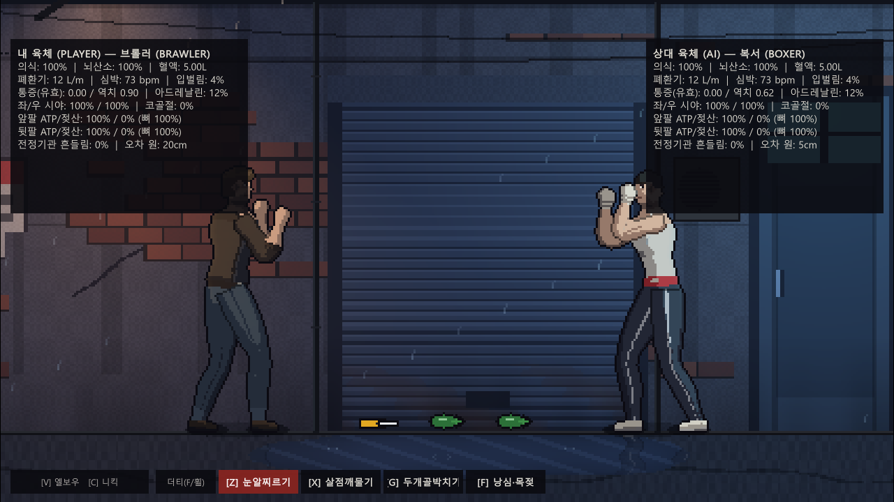
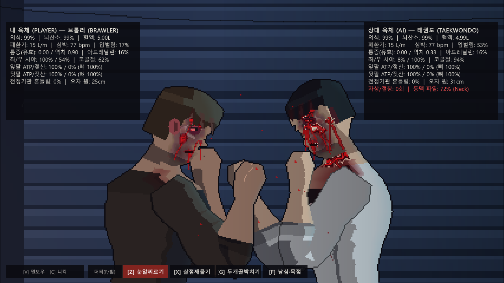
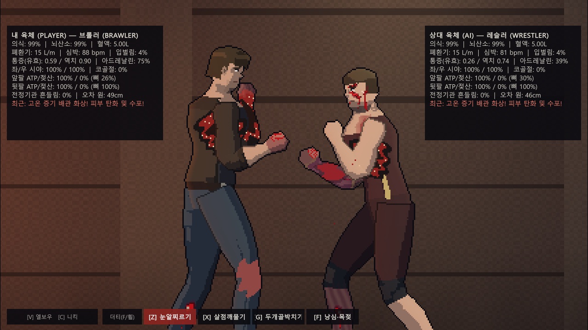

# FIGHT CLUB — V1

> 체력바 없는 극사실 해부학·생리 시뮬레이션 2D 픽셀 스트리트 파이팅 (Windows 64-bit)

가짜 HP·스태미나 바가 없습니다. 의식, 뇌산소, 혈액량, 근육 ATP·젖산, 뼈·관절 건전성, 동맥 출혈, 전정기관 평형 같은 **실제 의학·생리 지표**와 2D 액티브 래그돌 절차적 애니메이션으로 싸웁니다.

## ⬇️ 다운로드 & 실행

1. 오른쪽 **[Releases](../../releases/latest)** 에서 `FightClub_Windows_x64.zip` 을 받습니다.
2. 아무 폴더에 **압축을 전부 풉니다** (`FightClub_Data` 폴더가 `FightClub.exe` 옆에 있어야 합니다).
3. `FightClub.exe` 를 실행합니다.

- 설치 필요 없음 · Windows 10/11 64-bit
- 처음 실행할 때 Windows SmartScreen이 뜨면 **추가 정보 → 실행** 을 누르세요 (서명되지 않은 인디 빌드라서 그렇습니다).

## 🎮 기본 조작

| 동작 | 키 |
|---|---|
| 이동 / 숙이기 | `A` `D` / `S` |
| 앞손 · 뒷손 펀치 | 마우스 좌 · 우클릭 (누른 채 휙 끌면 **훅 · 어퍼컷**) |
| 가드 | `L-Shift` 또는 마우스 휠클릭 (커서 높이 = 가드 높이) |
| 앞발 · 뒷발 킥 | `Q` `E` (커서 높이로 로우 · 미들 · 하이) |
| 엘보우 · 니킥 | `V` `C` |
| 클린치 · 테이크다운 · 줍기 | `R` (레슬러: 클린치에서 `R` 꾹 → 들어 올린 뒤 `F` 메치기, `R` 그립 해제) |
| 더티 파이트 | `Z` 눈찌르기 · `X` 깨물기 · `G` 박치기 · `F` 선택 기술 (휠로 전환) |
| 흉기 | 좌클릭 베기 · 우클릭 찌르기 · `F` 투척 · `S`+`F` 내려놓기 |
| 테이크다운 방어 | `Alt`+휠↓ (또는 `Alt`+`S`) 스프롤 · `Alt`+휠↑ (또는 `Alt`+`W`) 언더훅 |
| 회피 · 탈출 · 기상 | `Space` (잡혔거나 쓰러졌을 때 연타) · `S`+`Space` 테이크다운 페인트 |
| 메뉴 · 인스펙트 · X-Ray | `ESC` · `I` · `F1` |

모든 키는 **옵션 → 키 바인딩**에서 바꿀 수 있습니다. 처음이라면 메인 메뉴의 **실전 튜토리얼 (9단계)** 부터 해보세요.

## 🥊 파이터 & 맵

- **복서** · **태권도** · **레슬러** · **브롤러** — 체급, 유연성, 통증 내성, 기술 숙련도가 모두 다릅니다.
- **비 내리는 뒷골목** · **지하 보일러실** · **녹슨 철망 폐차장** · **도축장 냉동 하역장** — 바닥 마찰, 벽 반동, 증기 화상, 바닥 흉기가 맵마다 다릅니다.

## 📸 스크린샷

## 📝 V1 패치 노트

**조작 · 전투**
- 마우스 드래그 훅 · 어퍼컷이 실제로 나가도록 입력 판정 수정
- 키보드 기본 가드(`L-Shift`) 추가 — 휠클릭이 불편하거나 트랙패드여도 가드 가능
- 실전 경기 중 `Tab` · `1~4` · `F2` · `Backspace` 오입력으로 경기가 초기화되던 문제 수정 (훈련 모드 전용으로 변경)
- 테이크다운 방어 키보드 대체 입력(`Alt`+`S` / `Alt`+`W`) 추가, 방어 보조키 바인딩 지원
- 레슬러 테이크다운 그립을 `R`로 직접 풀 수 있음

**무기 · AI · 밸런스**
- 바닥 흉기를 선수 사이가 아니라 등 뒤 · 벽 쪽에 배치 — 시작하자마자 칼싸움이 되는 문제 해결
- 브롤러 AI가 개시 직후 무기부터 줍던 행동 수정 (맨손 교전 후 / 불리할 때만 흉기 탐색)
- 다운된 상대 옆에서 레슬러가 병을 줍던 버그 수정
- 흉기를 든 채 클린치 · 태클하면 무기가 얼굴 앞에 떠 있던 연출 수정 (양손 그립 시 내려놓음)
- `F` 짓밟기를 흉기 소지 중에도 사용 가능, `S`+`F`로 흉기 내려놓기
- 투척물이 목 · 골반 · 다리 · 쓰러진 상대에게도 맞도록 판정 확장, 자갈 안구 100% 명중 편향 제거
- 보일러실 증기 배관 화상이 벽에 닿을 때만 들어가고, 쓰러진 몸에 반복되지 않도록 수정
- 칼을 막은 팔이 실제 방어한 팔(좌/우)에 상처가 남도록 수정, 고통 항복 판정 현실화

**튜토리얼 · UI · 사운드**
- 튜토리얼 9단계로 확장 (엘보우 · 니킥, 테이크다운 방어 · 기상 추가), 잘못된 안내와 판정 버그 수정
- 훈련 배지 · 더티 바 · 인스펙트 버튼 글자 잘림 / 깨짐 수정, 전투 상단 힌트에 배경 바 추가
- 메인 메뉴가 파이터를 가리지 않도록 카메라 구도 조정, 캐릭터 선택에 **배경 미리보기** 추가
- 비 오는 맵에서만 빗소리, 일시정지 중 생리음 · 타격음 정지, 오디오 스레드 안정성 개선
- X-Ray 패널에 코어 · 다리 스태미나 표시, 자유 훈련 `F7` 칼이 바닥에 쌓이던 문제 수정 외 다수

---

© byungshinsekki · 개인 인디 프로젝트. 실행 파일은 자유롭게 플레이할 수 있으나 재배포 · 판매는 금지합니다.
